# QMS Audit Compliance Dashboard

A full-stack Quality Management System built for a real client to manage ISO compliance programs. The app centralizes audit tracking, evidence management, and compliance workflows across three ISO frameworks — currently in active production use.

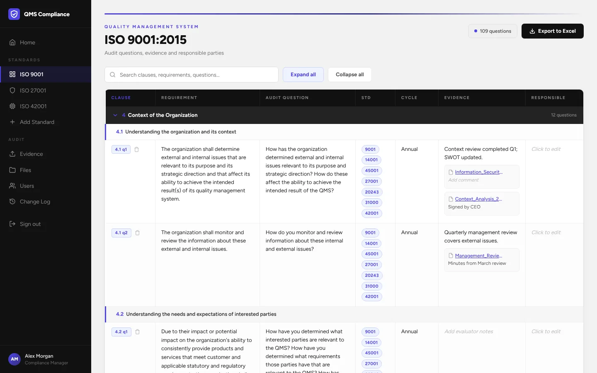

---

## Features

- **Three ISO frameworks out of the box** — ISO 9001 (quality), ISO 27001:2022 (information security) and ISO 42001 (AI management), covering 270+ audit questions and controls
- **Custom standard upload** — import any audit spreadsheet (Excel) and it becomes a first-class standard; the parser finds the header row, matches columns by name and infers the section/subsection/question hierarchy with no configuration
- **Inline editing** — click any field to edit it; changes save automatically and roll back with an error message if the server rejects them
- **Evidence management** — upload files once and link them to any number of clauses across standards, with a comment on each link
- **Change log / audit trail** — every edit, upload, link and account change is recorded server-side with who made it, as ISO traceability requires
- **Excel export** — one-click export of any standard, including evaluator notes and hyperlinked evidence files
- **Role-based access control** — Admin, User and Guest roles, enforced on every API route (JWT + bcrypt)
- **Search** — instant filtering on every standard, fuzzy search (Fuse.js) for files and clauses

---

## Screenshots

| | |
|---|---|
| 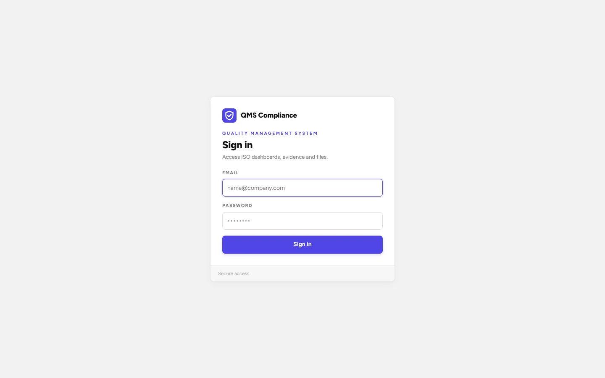 | 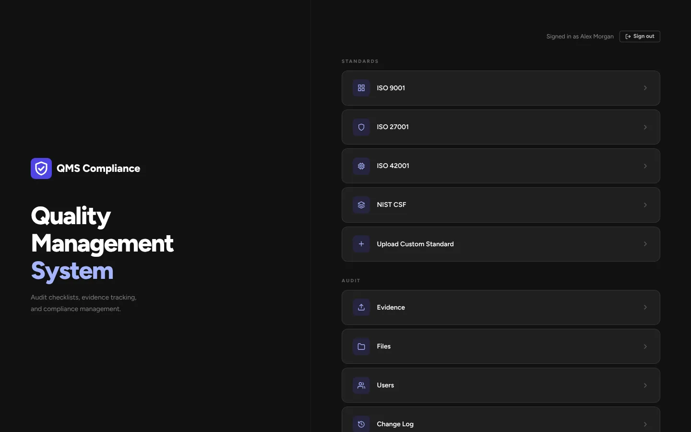 |
| 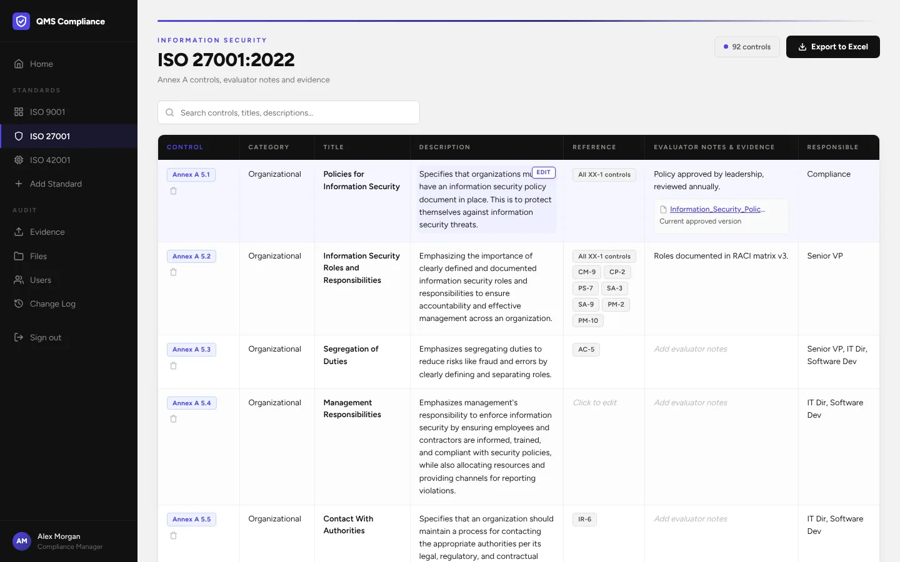 | 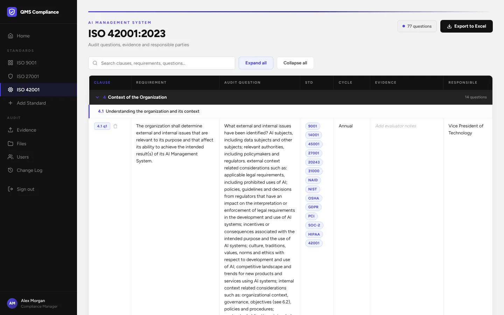 |
| 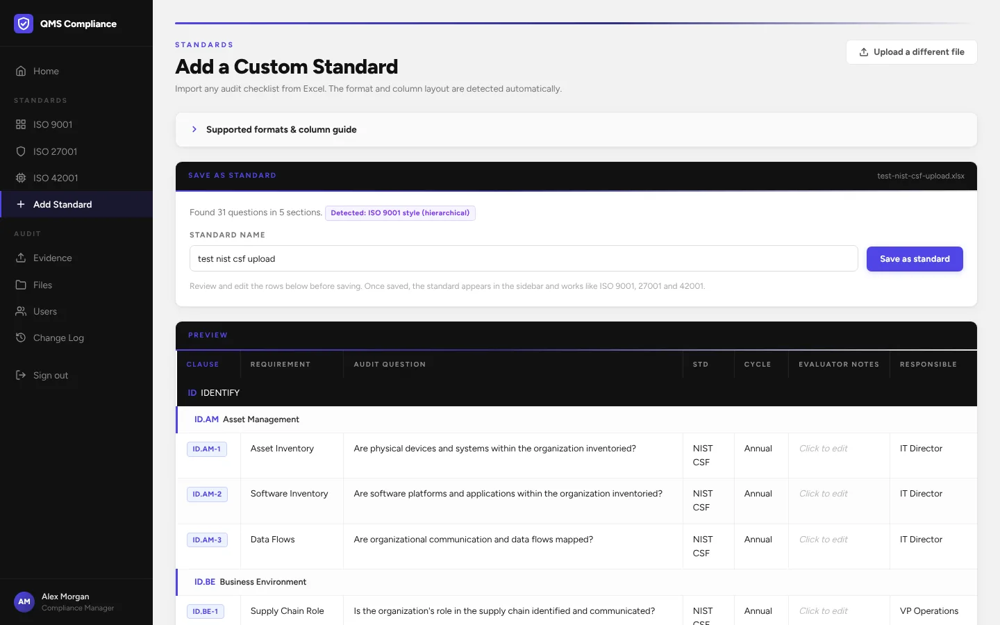 | 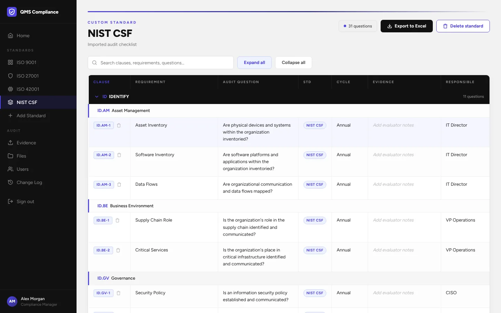 |
| 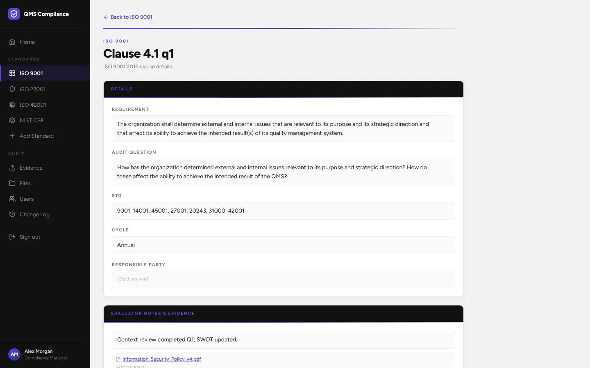 | 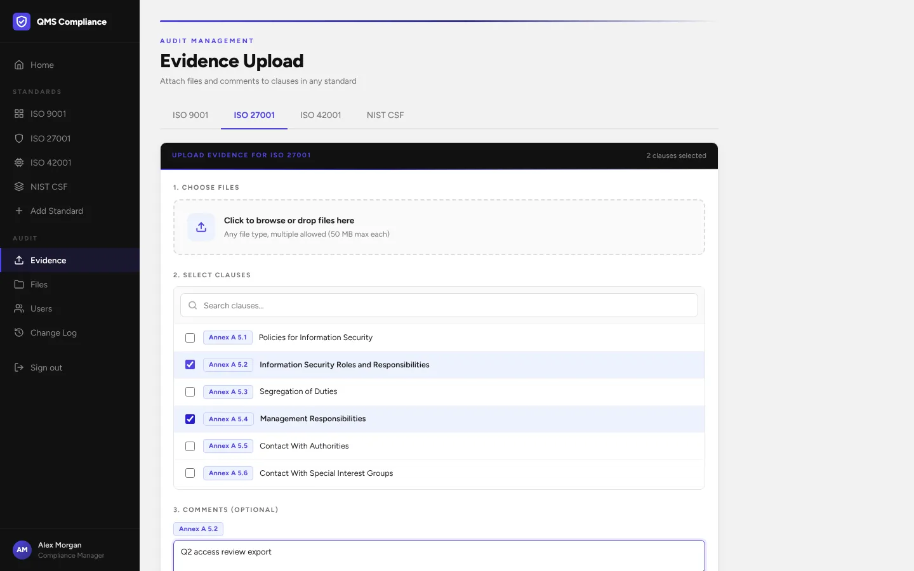 |
| 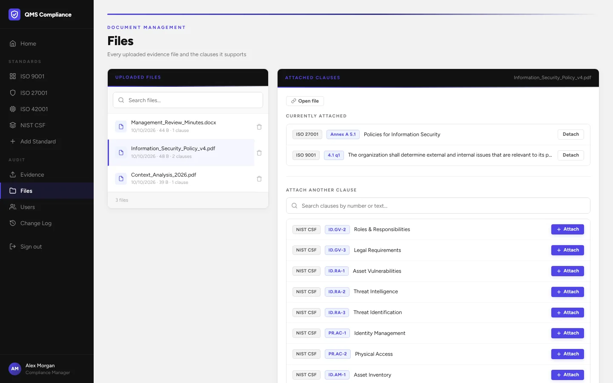 | 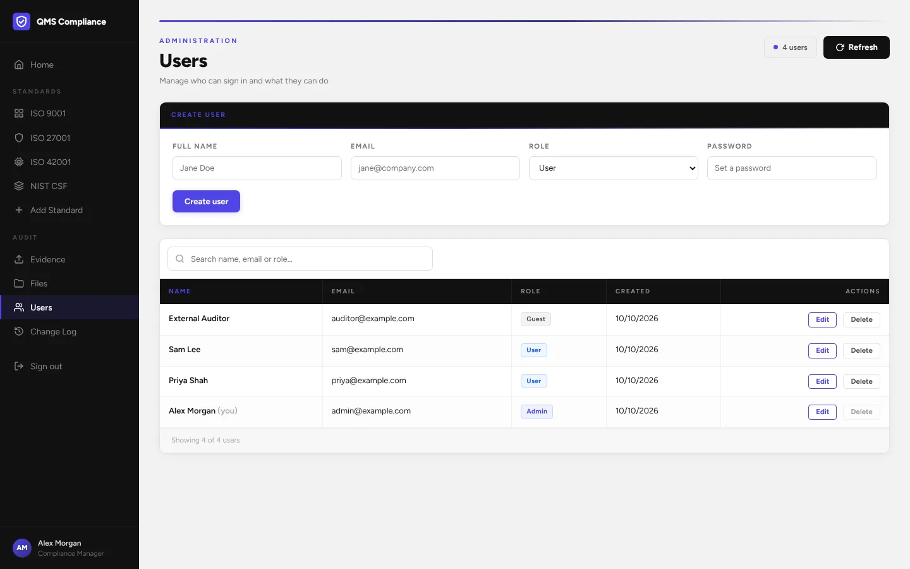 |
| 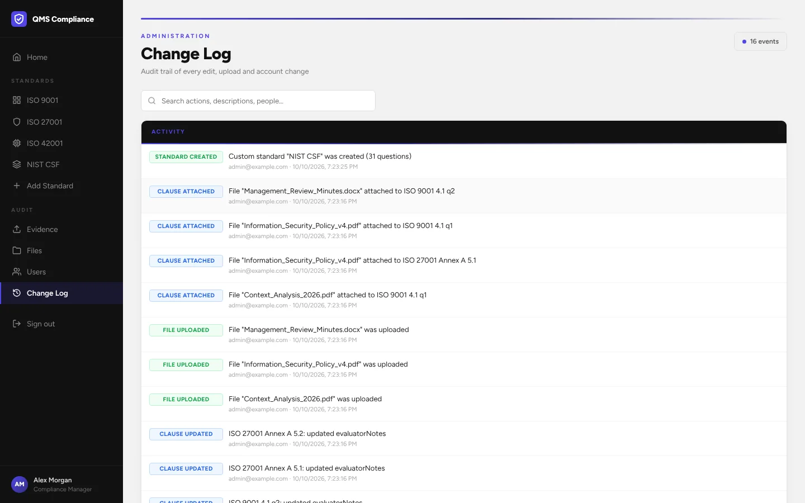 | |

---

## Tech Stack

| Layer | Technology |
|---|---|
| Frontend | React 19, Vite, React Router, a custom CSS design system |
| Backend | Node.js, Express 5 |
| Database | PostgreSQL 16 (Docker) |
| ORM | Prisma |
| Auth | JWT + bcrypt, role-based middleware |
| File handling | Multer |
| Spreadsheets | SheetJS (import and export) |
| Search | Fuse.js |
| Testing | Vitest + React Testing Library (frontend), Jest + Supertest (backend), ESLint |

### How it's built

- **Standards are data.** Every clause of every standard lives in one `Clause` table with a `standard` column, so an uploaded spreadsheet becomes a working standard without any schema or code changes.
- **One component library.** All pages are built from shared components (`PageHeader`, `Panel`, `InlineEdit`, `ChecklistTable`, …) styled by a single token-based stylesheet. ISO 9001, ISO 42001 and every custom standard render through the same `ChecklistPage`.
- **Thin data layer.** A single API client, a provider that caches clause rows per standard with optimistic updates, and two hooks (`useStandard`, `useFiles`) are all a page needs.
- **Security on the server.** Every `/api` route checks the JWT and role; the frontend only hides controls for convenience.

See [docs/](docs/README.md) for architecture diagrams, the full API reference and user flows.

---

## Getting Started

### Prerequisites

- [Node.js](https://nodejs.org/) v20+
- [Docker Desktop](https://www.docker.com/products/docker-desktop/)
- [Git](https://git-scm.com/)

### Setup

**1. Clone the repo**
```bash
git clone https://github.com/sharif-hassan/qms-audit-compliance-dashboard.git
cd qms-audit-compliance-dashboard
```

**2. Create the backend config file**
```bash
cp qms-server/.env-example qms-server/.env
```

The defaults match the Docker database. Change `JWT_SECRET` to a long random string for anything other than local development.

**3. Install dependencies**
```bash
npm install
cd qms-server && npm install && cd ..
```

**4. Start everything**

Make sure Docker Desktop is running, then:
```bash
# Mac/Linux
./start.sh

# Windows (PowerShell)
powershell -ExecutionPolicy Bypass -File .\start.ps1
```

This starts the database, runs migrations, seeds the built-in standards and launches both servers. Re-running it is safe: the seed never overwrites your edits.

**5. Open the app**

Go to [http://localhost:5173](http://localhost:5173) and log in with:

```
Email:    admin@example.com
Password: admin123
```

Change this password from the **Users** page after your first login.

---

## Testing

```bash
npm run lint                  # ESLint for frontend and backend
npm test                      # frontend tests (Vitest)
cd qms-server && npm test     # backend tests (Jest + Supertest)
```

The frontend suite covers the spreadsheet parser, the checklist page (rendering, search, editing, export, read-only guests), inline editing, the upload flow and the API client. The backend suite covers every route, authentication, role checks and the audit trail.

### Trying the custom standard upload

The `docs/` folder includes sample spreadsheets in different layouts:

| File | Format |
|---|---|
| `docs/test-iso27001-style-upload.xlsx` | ISO 27001 flat format |
| `docs/test-soc2-upload.xlsx` | Hierarchical, numeric clauses |
| `docs/test-gdpr-upload.xlsx` | Flat format grouped by category |
| `docs/test-nist-csf-upload.xlsx` | Hierarchical, non-numeric outline (`ID` → `ID.AM` → `ID.AM-1`) |

Go to **Add Standard** in the sidebar, upload one of the files, review the preview and save it.

---

## Project Structure

```
qms-audit-compliance-dashboard/
├── src/                        # React frontend
│   ├── pages/                  # One component per route
│   ├── components/             # ChecklistTable, EvidenceCell, AppShell
│   │   └── ui/                 # Design-system primitives (Button, Panel, InlineEdit, …)
│   ├── state/                  # GlobalProvider (auth + clause cache), toasts
│   ├── hooks/                  # useStandard, useFiles
│   ├── utils/                  # Excel import/export, formatting
│   ├── api.js                  # API client
│   ├── standards.js            # Registry of standards
│   └── styles.css              # Design tokens and component styles
├── qms-server/                 # Express backend
│   ├── src/
│   │   ├── routes/             # auth, clauses, files, users, changelog
│   │   ├── middleware/         # JWT auth + role enforcement
│   │   └── utils/              # Change-log helper
│   └── prisma/
│       ├── schema.prisma       # Database schema
│       ├── seed.js             # Database seeder
│       └── data/               # ISO 9001 / 27001 / 42001 clause catalogs
├── docs/                       # Architecture docs, screenshots, sample uploads
├── docker-compose.yml          # PostgreSQL container
├── start.ps1                   # Windows one-command startup
└── start.sh                    # Mac/Linux one-command startup
```

---

## Documentation

Detailed technical docs live in the `docs/` folder:

- `architecture.md` — system overview and component diagram
- `api.md` — full API reference
- `auth.md` — JWT lifecycle and role-based access
- `data-model.md` — ER diagram and schema
- `custom-standards.md` — how the Excel ingestion pipeline works
- `flows.md` — sequence diagrams for key user flows
- `frontend.md` — routing, state and the component library
- `development.md` — local setup, testing, and debugging guide
