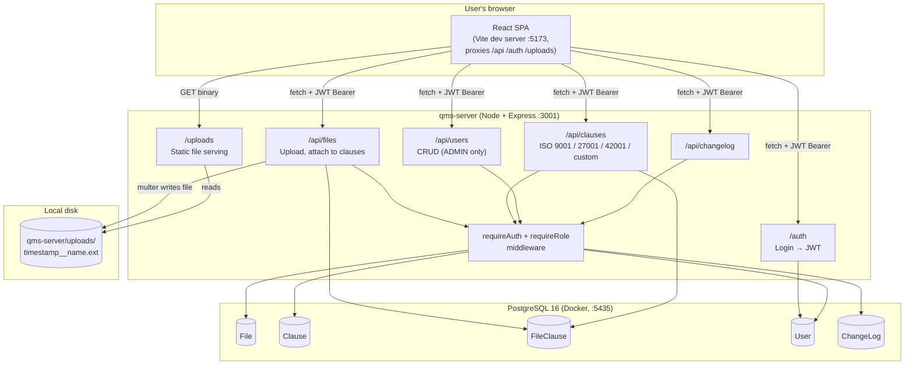
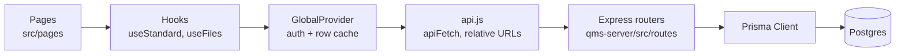
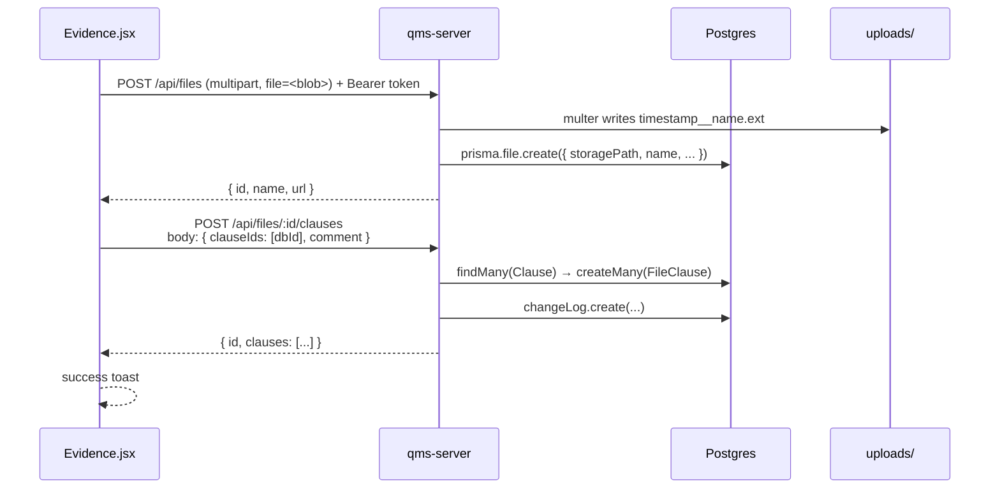

# Architecture

## System overview

## Tech stack

| Layer | Technology | Version |
|---|---|---|
| Frontend framework | React | 19.2 |
| Build tool | Vite | 7.2 |
| Routing | react-router-dom | 7.12 |
| Fuzzy search | fuse.js | 7.1 |
| Excel import/export | SheetJS (`xlsx`) + `file-saver` | 0.18 / 2.0 |
| Backend framework | Express | 5 |
| ORM | Prisma | 6 |
| Database | PostgreSQL | 16 |
| Auth | `jsonwebtoken` + `bcrypt` | — |
| File uploads | `multer` (disk storage) | — |
| Test runner (frontend) | Vitest + Testing Library | — |
| Test runner (backend) | Jest | — |

## Layered view

- **Pages** are thin: they compose shared components (`PageHeader`, `Panel`, `ChecklistTable`, `InlineEdit`, …) and keep only local UI state such as the search box. See [frontend.md](frontend.md).
- **`GlobalProvider`** holds the signed-in user and a per-standard cache of clause rows. Edits are optimistic and roll back if the server rejects them.
- **`api.js`** is the only place that calls `fetch`. It attaches the JWT and turns error responses into `ApiError`s.
- **Routers** each own one resource and apply `requireAuth` / `requireRole` to every route. Every write records a change-log entry.
- **Prisma** is the only thing that talks SQL.

## Request anatomy (evidence upload)

Uploading the file is separate from linking it, so one file can back many clauses. The Evidence page sends one link request per selected clause so each link keeps its own comment.

## Where files physically live

Binary uploads land in `qms-server/uploads/` with a filename like `1712345678901__audit_report.pdf` (unix millis + double underscore + sanitized original name). Only the path is stored in Postgres (`File.storagePath`). The backend exposes the directory at `/uploads/...` via `express.static`, and the API returns links like `/uploads/1712345678901__audit_report.pdf`.

## Data lifecycle

1. **Seed** — `npx prisma db seed` reads the clause catalogs in [qms-server/prisma/data/](../qms-server/prisma/data/) and creates any missing rows in the `Clause` table, with codes like `iso9001_4.1 q1`, `iso27001_Annex_A_5.1`, `iso42001_4.1 q1`. It also creates the default admin. It is safe to re-run: existing clauses keep their edits and the admin keeps their password.
2. **Custom standard upload** — [CustomISO.jsx](../src/pages/CustomISO.jsx) parses an xlsx in the browser, detects the header row, and POSTs the rows to `/api/clauses/custom` where they are stored with `standard = "custom_<slug>"` and `code = custom_<slug>_<index>`.
3. **Evidence upload** — See sequence diagram above. Files live on disk, metadata in `File`, relationships in `FileClause`.
4. **Inline edits** — Every clause page saves one field at a time with a PATCH (`{ field: "isoClause", value: "..." }`).

## Why these choices

- **One big `Clause` table** with a `standard` column, not one table per standard. This is what lets custom standards slot in without schema changes — they just pick a new `standard` value like `custom_gdpr`.
- **`FileClause` as a join table** lets one file back many clauses and vice versa. A single policy PDF can satisfy a 9001, 27001, and 42001 clause at once.
- **The frontend caches clause rows per standard** in `GlobalProvider`, so navigating between pages doesn't refetch, and inline edits update the cache optimistically.
- **One checklist component for every hierarchical standard.** ISO 9001, ISO 42001 and custom uploads share `ChecklistPage`, so a fix or feature lands everywhere at once.
