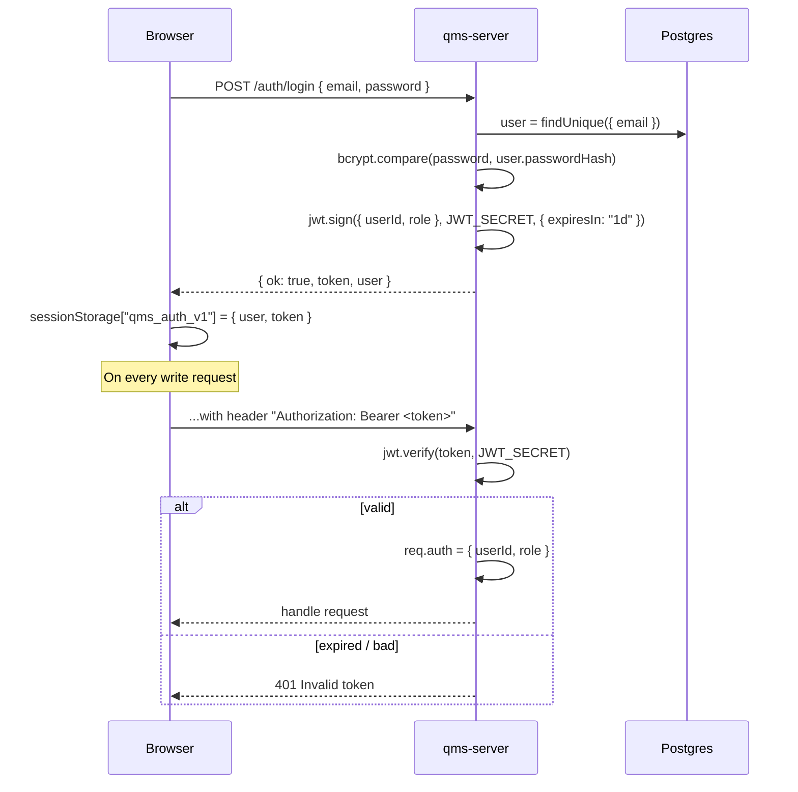

# Authentication & Authorization

JWT-based, stateless, three roles. Login yields a signed token that the frontend carries on every write.

## Token lifecycle



- Tokens are **session-scoped** on the client (`sessionStorage`). Close the tab → you're logged out.
- Tokens are **not refreshed** automatically. After 1 day they return 401 and the user has to log in again.
- `JWT_SECRET` must be in `qms-server/.env` — the backend exits on missing secret. Rotate it and every issued token becomes invalid immediately (a poor man's global logout).

## Roles

Defined in [schema.prisma](../qms-server/prisma/schema.prisma) as a Postgres enum:

```prisma
enum Role { USER  ADMIN  GUEST }
```

| Role | Intent | Can write clauses? | Can manage users? | Sees Change Log? |
|---|---|---|---|---|
| `ADMIN` | Compliance manager | Yes | Yes | Yes |
| `USER` | Engineer / auditor | Yes | No | No |
| `GUEST` | Read-only observer | No | No | No |

## Three layers of enforcement

The same check is applied at three levels so if one fails the others catch it:

### 1. Backend middleware (the one that actually matters)

[qms-server/src/middleware/auth.js](../qms-server/src/middleware/auth.js)

```js
function requireAuth(req, res, next) {
  const token = (req.headers.authorization || "").startsWith("Bearer ")
    ? req.headers.authorization.slice(7)
    : null;
  if (!token) return res.status(401).json({ ok:false, message:"Missing token" });
  try {
    req.auth = jwt.verify(token, process.env.JWT_SECRET); // { userId, role, email }
    return next();
  } catch { return res.status(401).json({ ok:false, message:"Invalid token" }); }
}

function requireRole(...roles) {
  return (req, res, next) => {
    if (!req.auth) return res.status(401).json({ ok:false, message:"Not authenticated" });
    if (!roles.includes(req.auth.role)) return res.status(403).json({ ok:false, message:"Forbidden" });
    return next();
  };
}
```

Applied to every `/api` route. For example:

```js
router.post("/", requireAuth, requireRole("ADMIN", "USER"), uploadHandler);
```

### 2. Route guards in React

[src/components/ProtectedRoute.jsx](../src/components/ProtectedRoute.jsx) wraps a page:

```jsx
<Route path="/evidence" element={
  <ProtectedRoute allowedRoles={["ADMIN", "USER"]}><Evidence /></ProtectedRoute>
}/>
```

If the current `user.role` isn't in `allowedRoles`, the guard bounces to Landing. This prevents the UI from even rendering the page — a user who shouldn't be editing evidence never sees the form.

### 3. Hiding controls in the UI

[src/components/AppShell.jsx](../src/components/AppShell.jsx), the landing page and each page use the helpers in [permissions.js](../src/permissions.js) to hide links and buttons:

```jsx
{canEdit(user) && <NavItem to="/evidence" icon="upload" label="Evidence" />}
{isAdmin(user) && <NavItem to="/users" icon="users" label="Users" />}
<InlineEdit value={row.cycle} onSave={saveField(row, "cycle")} canEdit={canEdit(user)} />
```

This is cosmetic — the backend middleware is the real check — but it keeps the UI calm for read-only users.

## What each role can do

| Action | GUEST | USER | ADMIN |
|---|:-:|:-:|:-:|
| Read standards, clauses, files | ✓ | ✓ | ✓ |
| Edit clause fields, upload/link evidence | | ✓ | ✓ |
| Create a custom standard | | ✓ | ✓ |
| Delete clauses or custom standards | | | ✓ |
| Manage users, read the change log | | | ✓ |

Every `/api` route checks the token and role on the server. The frontend hides controls the user can't use (via [permissions.js](../src/permissions.js)), but that's only presentation.

## Authorization notes

- **Change log entries are written by the server only.** There is no endpoint to create one, and each entry records the email from the caller's token.
- **Admins can't lock themselves out.** The API refuses to delete your own account or remove your own admin role.
- **`GET /uploads/<file>` is not protected.** Once someone knows a URL they can fetch it. If uploads contain sensitive documents, serve them through an authenticated route or signed URLs.
- **Role is baked into the token.** Changing a user's role doesn't affect a token they already hold; it applies at their next login (tokens last one day).
- **Expired tokens sign the user out.** Any `401` from the API clears the session in the frontend.

## Making authenticated requests from the frontend

Use `request()` from `useGlobal()`; it attaches the token and handles errors:

```js
const { request } = useGlobal();
const users = await request("/api/users");
await request(`/api/users/${id}`, { method: "PATCH", body: { role: "USER" } });
```

Failures throw an `ApiError` with the server's message and `status`.

## Password storage

Passwords are bcrypt-hashed with 10 rounds in [auth.js](../qms-server/src/routes/auth.js) and [users.js](../qms-server/src/routes/users.js). Raw passwords never leave a request body — they are hashed before the Prisma call and discarded.

## Adding a new role

1. Add the enum value to [schema.prisma](../qms-server/prisma/schema.prisma) under `Role`.
2. `npx prisma migrate dev --name add_<role>_role`.
3. Update `ALLOWED_ROLES` in [qms-server/src/routes/users.js](../qms-server/src/routes/users.js) so admins can assign it.
4. Add the role to every relevant `requireRole(...)` call.
5. Update [permissions.js](../src/permissions.js) and the `allowedRoles` in [App.jsx](../src/App.jsx).
