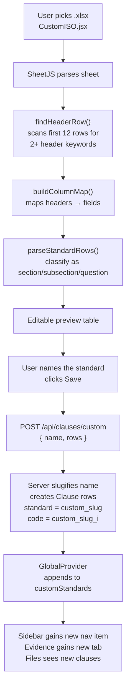

# Custom Standards

The ability to ingest arbitrary audit spreadsheets and have them behave like first-class ISO standards. The parser lives in [parseStandardWorkbook.js](../src/utils/parseStandardWorkbook.js) (used by [CustomISO.jsx](../src/pages/CustomISO.jsx)), rows are stored in the same `Clause` table as the built-ins, and they render through the same `ChecklistPage` as ISO 9001 and 42001.

## End-to-end pipeline



Critically: **the server never sees an xlsx**. Parsing happens entirely in the browser, the server just receives an array of already-shaped rows.

## Parsing — how it reads weird sheets

Compliance spreadsheets are notoriously inconsistent. Real-world audit workbooks have:

- The header row anywhere from row 1 to row 9
- Columns named "Clause", "Clause No.", "Control", "Standard" (all meaning different things)
- "Description" appearing twice (first = short title, second = full text)
- Evidence columns named "Evidence", "Evaluator Notes", "Observations"
- Merged header rows above the real column headers

[parseStandardWorkbook.js](../src/utils/parseStandardWorkbook.js) handles this with a few pure, unit-tested helpers:

### `findHeaderRow(rows)`

Scans the first 12 rows. For each row, counts how many cells contain one of the keywords `standard / clause / control / iso / audit / evidence / responsible / type / description / evaluator / reference / cycle / std`. The first row with **two or more hits** is the header. Falls back to row 0 if nothing matches.

### `buildColumnMap(headerRow)`

Walks each header cell and produces a `{ field: columnIndex }` map. Key decisions:

- **"ISO Clause"** wins over bare **"Clause"** (check is ordered). When a sheet has both **"Clause No."** and **"Clause"**, the first is the clause number and the second the requirement text.
- **"Evaluator Notes"** (27001 style) or **"Evidence"** become the row's evaluator notes.
- **"Standard"** is treated as the clause ID when there's no bare "Clause" column (ISO 27001 calls their IDs "Standard" like *Annex A 5.1*).
- **"Description"** is mapped twice: first occurrence → `title`/`isoClause`, second → `description`/`auditQuestion`.

This means a sheet with headers `["Standard", "Category", "Title", "Description", "Evaluator Notes", "Responsible"]` (a typical ISO 27001 gap-analysis workbook) maps correctly without any user configuration.

### Row classification

`detectFormat()` picks one of four layouts from the mapped columns:

| Format | Detected when | Row types |
|---|---|---|
| `iso27001` | Control + Description columns, no ISO Clause column | Every row is a question; a section header is inserted whenever **Control** changes |
| `typed` | A **Type** column exists | `header`/`section`/`subsection` → heading (`4.1`-style numbers become subsections), `question` → question, anything else skipped |
| `iso9001` / `generic` | Otherwise | Inferred from the clause number: `4` → section, `4.1` / `4.1.2` → subsection, anything else → question |

For non-numeric outlines (e.g. NIST CSF's `ID` → `ID.AM` → `ID.AM-1`) the clause number alone isn't enough, so a row with a title but no audit question, std, cycle, evidence or responsible party is treated as a heading: a section if its id has no `.`, `-` or space, otherwise a subsection.

Blank rows are skipped. The user can review and edit every question in the preview before saving.

## Storage

On `POST /api/clauses/custom` with `{ name: "My Standard", rows: [...] }`:

1. Server slugifies: `"My Standard"` → `"my_standard"`.
2. Checks for collision — `409` if another standard already uses that slug.
3. For each row, creates a `Clause`:

```js
{
  code:             `custom_my_standard_${i}`,
  standard:         "custom_my_standard",
  type:             row.type,               // "section" / "subsection" / "question"
  title:            row.clause,             // display clause number, e.g. "4.1"
  isoClause:        row.isoClause,
  auditQuestion:    row.auditQuestion,
  std:              row.std,
  cycle:            row.cycle,
  responsibleParty: row.responsibleParty,
  evaluatorNotes:   row.evaluatorNotes,      // from an Evidence / Evaluator Notes column
  category:         row.category,
  description:      name,                    // stored on every row — used to reconstruct display name
  reference:        row.reference,
}
```

The display name is stored on every row in the `description` column. `GET /api/clauses/custom` reads one row per `standard` prefix to rebuild the `{ slug, name }[]` list.

## Why the column names are different from built-ins

Built-in ISO standards store the clause display ID in `code` (with prefix stripped before display). Custom standards can't do this cleanly because their "clause numbers" are arbitrary strings from the spreadsheet — the backend-assigned `code` is a boring `custom_slug_42`. So:

| Field | Built-in | Custom |
|---|---|---|
| Clause display ID | `code.replace("iso9001_", "")` = `"4.1"` | `title` = `"4.1"` |
| Clause text | `isoClause` | `isoClause` |
| Primary key for linking | `id` (exposed to the frontend as `dbId`) | `id` (`dbId`) |

All standards link files by the database id, so evidence attaches the same way everywhere.

## Everything "just works" because standards are data, not code

Once a custom standard is uploaded it's just more rows in the `Clause` table with a new `standard` value. Therefore:

- **Sidebar and landing page** — both list `allStandards(customStandards)` from [standards.js](../src/standards.js).
- **Evidence page tabs** — same list; opening a tab calls `loadStandard("custom:<slug>")`.
- **Files page clause picker** — `GET /api/clauses` already returns custom rows; the picker filters `type === "question"` and there they are.
- **Attached clauses on a file** — `GET /api/files` joins through `FileClause` with no awareness of standard, so a file attached to a custom clause shows up just like a file attached to an ISO 9001 clause.

Adding a new *kind* of standard (say, **SOC 2**) requires zero code changes. Upload the spreadsheet, it becomes `standard = "custom_soc_2"`.

## The standard's page

[CustomStandardPage.jsx](../src/pages/CustomStandardPage.jsx) at `/custom/:slug` renders the shared [ChecklistPage](../src/pages/ChecklistPage.jsx) — the exact page used for ISO 9001 and 42001 — plus a **Delete standard** button for admins. That gives custom standards inline editing, evaluator notes, evidence files with per-link comments, search, collapsible sections, clause detail pages and Excel export for free.

## Failure modes

| Symptom | Cause | Fix |
|---|---|---|
| `409 A standard with this name already exists` | Slug collision on upload | Pick a different name, or delete the existing standard |
| "No rows found" after choosing a file | The header row wasn't detected | Make sure one of the first 12 rows has at least two recognised column names (Clause, Standard, Control, ISO Clause, …) |
| Questions show up as headings (or the reverse) | The clause numbering doesn't follow the rules above | Add a **Type** column with `header` / `question` values |

## Test samples in this folder

- [test-iso27001-style-upload.xlsx](test-iso27001-style-upload.xlsx)
- [test-soc2-upload.xlsx](test-soc2-upload.xlsx)
- [test-nist-csf-upload.xlsx](test-nist-csf-upload.xlsx)
- [test-gdpr-upload.xlsx](test-gdpr-upload.xlsx)

Use these to sanity-check the parser after changing it, alongside the unit tests in [parseStandardWorkbook.test.js](../src/__tests__/parseStandardWorkbook.test.js).
