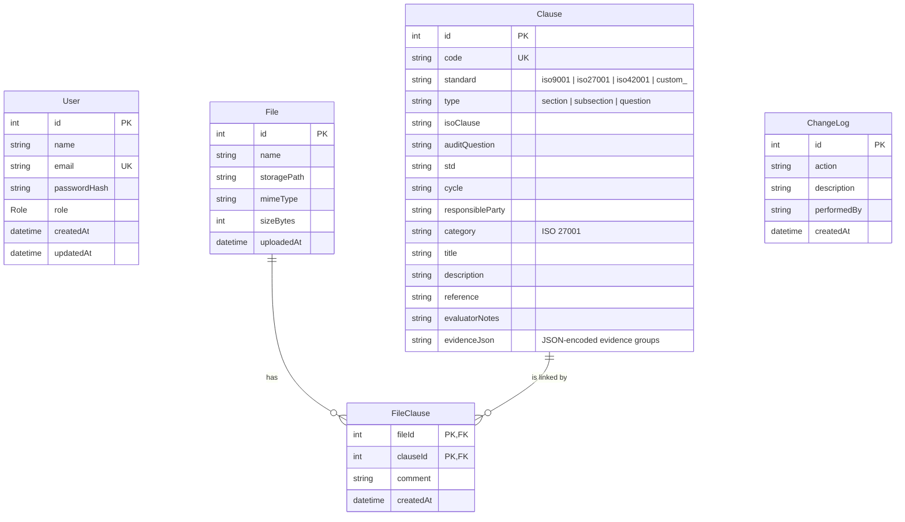
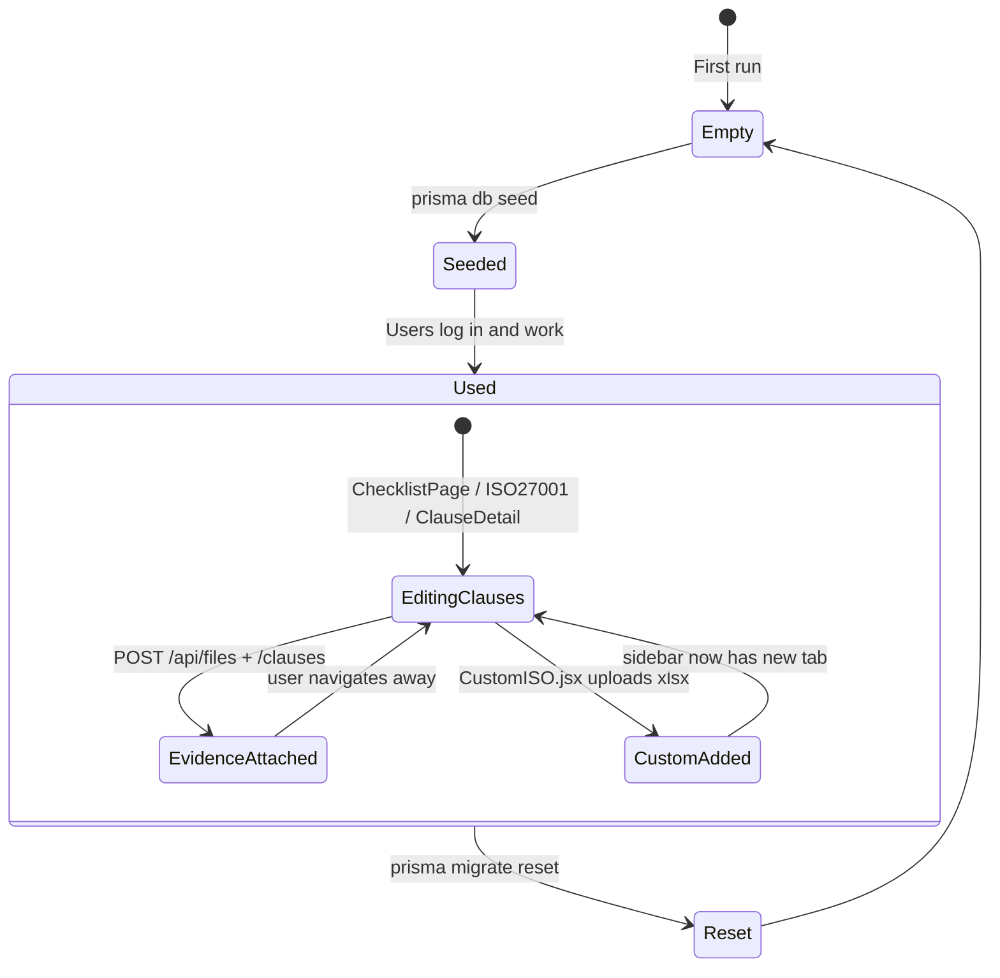

# Data Model

The database is Postgres. All SQL goes through Prisma — there are no hand-written queries in the repo. The authoritative schema lives at [qms-server/prisma/schema.prisma](../qms-server/prisma/schema.prisma).

## ER diagram



## Tables in detail

### `user` (Role enum: `USER` / `ADMIN` / `GUEST`)

Authentication source of truth. `passwordHash` is bcrypt (`saltRounds = 10`). The seed script upserts `admin@example.com / admin123` as an ADMIN on first boot — change this before anyone else runs it.

Role mapping in the UI:

| Role | Can see in sidebar | Can hit write endpoints |
|---|---|---|
| ADMIN | Everything, including Users and Change Log | Yes, all |
| USER | Standards, Evidence, Files, Custom Upload | Yes, most (not Users/Changelog) |
| GUEST | Standards only | No writes — read-only |

### `Clause`

One row per clause/control/question across every standard. The `standard` column is the discriminator:

| `standard` value | Came from |
|---|---|
| `iso9001` | Seeded from [iso9001.json](../qms-server/prisma/data/iso9001.json) |
| `iso27001` | Seeded from [iso27001.json](../qms-server/prisma/data/iso27001.json) |
| `iso42001` | Seeded from [iso42001.json](../qms-server/prisma/data/iso42001.json) |
| `custom_<slug>` | Uploaded via the *Add Standard* page |

`code` is unique across the whole table. The prefix convention lets the backend and the export helpers figure out which standard a row belongs to just from the code:

- `iso9001_4.1`
- `iso27001_Annex_A_5.1` (spaces become `_`)
- `iso42001_4.1`
- `custom_my_standard_0` (zero-indexed within that standard)

`type` gives the row's hierarchy role:

- `section` — top-level header (rendered as a dark stripe)
- `subsection` — nested header
- `question` — an actual audit question/control, the only type that can accept evidence

Evidence is stored two ways on a clause:

1. **Normalized** — rows in `FileClause` joining this clause to uploaded `File`s. This is the canonical relational representation.
2. **JSON** — `evidenceJson` can hold a JSON array of `{ files: [...], comment }` groups. This is a legacy path; the current UI only uses `FileClause` rows. (Older versions also stored this JSON in `evaluatorNotes` for custom standards — the API still reads that format and turns it into notes.)

`evaluatorNotes` holds the auditor's free-text notes for the clause.

### `File`

One row per binary upload. `storagePath` is the absolute path on disk (multer writes it). `name` is the original filename the user uploaded. The public URL is derived as `/uploads/<basename(storagePath)>`.

`onDelete: Cascade` on `FileClause.fileId` means deleting a file also wipes all its clause links, and deleting a clause wipes all links *to* that clause.

### `FileClause`

The many-to-many join. Composite primary key `(fileId, clauseId)` ensures a file cannot be attached to the same clause twice. `comment` is a per-link note (used when a single upload has one comment for one clause).

### `ChangeLog`

An append-only audit trail written by the server whenever a clause, standard, file link or user changes ([utils/changelog.js](../qms-server/src/utils/changelog.js)). `performedBy` is the email of the user who made the change. Read through `GET /api/changelog` (admins only) and rendered in [ChangeLog.jsx](../src/pages/ChangeLog.jsx).

## State flows



## Migrations

Migrations live under [qms-server/prisma/migrations/](../qms-server/prisma/migrations/). They are applied with:

```
cd qms-server
npx prisma migrate deploy     # production / fresh install
npx prisma migrate dev        # development — makes a new migration
npx prisma db seed            # run seed.js
```

The `start.ps1` / `start.sh` scripts run `migrate deploy` then `db seed` automatically.

## Non-obvious invariants

- **`Clause.code` encodes the standard.** Built-in routes look clauses up by `<standard>_<clause number>`, so don't mint codes that break the prefix convention.
- **Custom standard slugs are derived server-side** from the display name (`"My Standard" → "my_standard"`). Duplicate names fail with `409`. See `POST /api/clauses/custom` in [api.md](api.md).
- **The seed never overwrites existing rows.** It only creates missing clauses (and refreshes their `standard`/`type`), so re-running it keeps users' edits and the admin's password.
