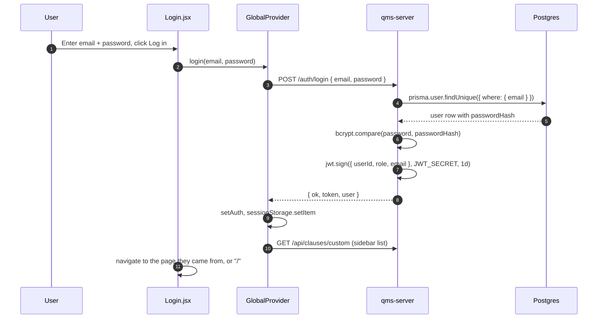
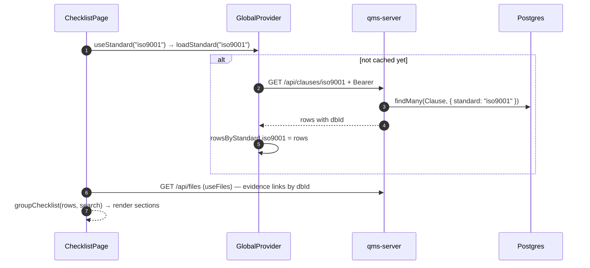
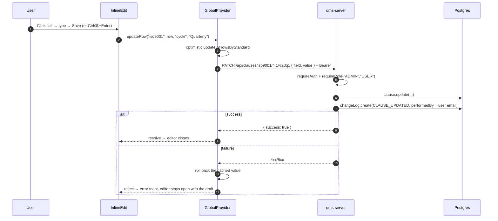
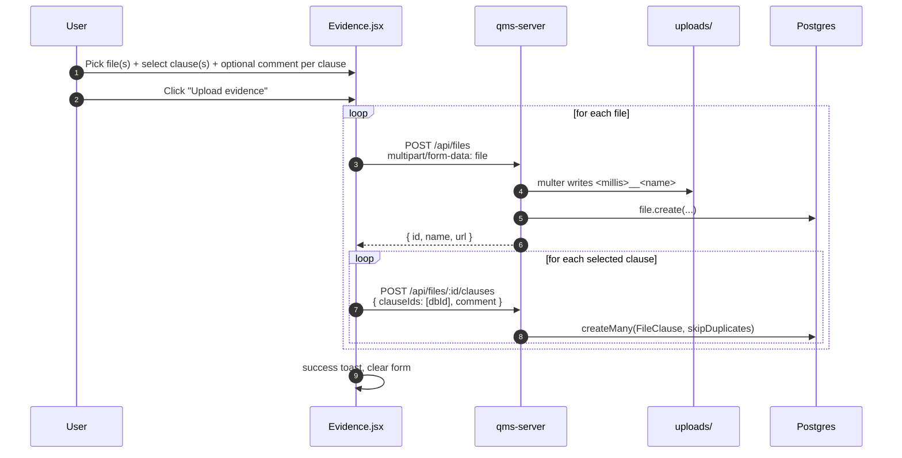
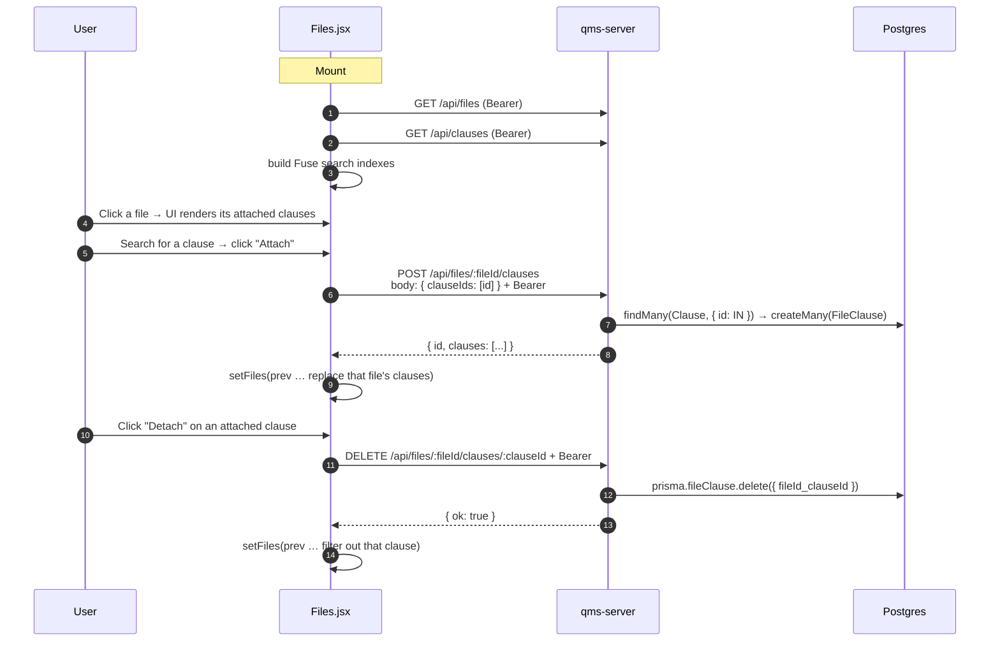
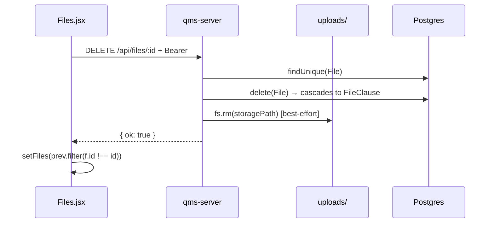
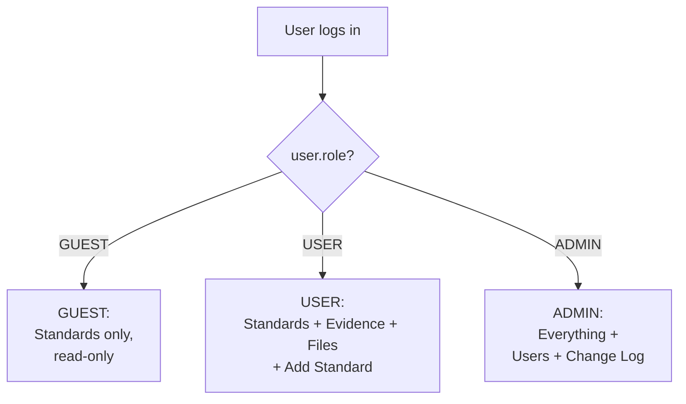

# User Flows

Sequence diagrams for the paths users actually walk through. Each one ties frontend files, backend routes, and database tables together.

## 1. Login



Tokens expire after 1 day. When any request comes back `401`, the provider signs the user out and the router sends them to the login page.

## 2. Viewing a standard (ISO 9001 example)



Each standard is fetched the first time a page needs it and then served from the cache.

## 3. Inline editing a clause field



## 4. Uploading evidence (built-in standard)



Clauses are always linked by their database id (`dbId`), for built-in and custom standards alike. Opening the Evidence page from a clause's detail page pre-selects that clause.

## 5. Uploading a custom standard (xlsx)

```mermaid
sequenceDiagram
    autonumber
    participant U as User
    participant UI as CustomISO.jsx
    participant GC as GlobalProvider
    participant API as qms-server
    participant DB as Postgres

    U->>UI: Drag-drop or browse → pick .xlsx
    UI->>UI: SheetJS → parseStandardRows() → rows[]
    UI->>UI: Editable preview; name pre-filled from the file name
    U->>UI: Click "Save as standard"
    UI->>GC: createCustomStandard(name, rows)
    GC->>API: POST /api/clauses/custom<br/>body: { name, rows } + Bearer (ADMIN or USER)
    API->>API: slug = slugify(name)
    API->>DB: findFirst(Clause, { standard: "custom_" + slug })
    alt already exists
        DB-->>API: row
        API-->>GC: 409 Conflict
        GC-->>UI: throw → "standard already exists"
    else new
        API->>DB: createMany(Clause, rows.map with code: custom_<slug>_<i>)
        API-->>GC: { slug, name }
        GC->>GC: setCustomStandards(prev → [...prev, {slug,name}])
        GC-->>UI: slug
        UI->>UI: navigate("/custom/" + slug)
    end
```

The parsing is entirely in the browser — the server doesn't see an xlsx, only the row array. See [custom-standards.md](custom-standards.md) for how the parser handles messy sheets.

## 6. Files page — attach a clause to a file



`GET /api/clauses` returns *every* clause across every standard in one payload. The frontend filters to `type === "question"` rows before rendering. This is why custom standards appear automatically in the Files clause picker — they're just more rows in the same table.

## 7. Deleting a file



The cascade on `FileClause.fileId` means you don't have to delete the join rows manually — Postgres does it. The disk unlink is best-effort: if it fails, the DB is already clean and the orphan on disk can be garbage-collected by any sweep.

## 8. Role-gated navigation



See [auth.md](auth.md) for where each role is enforced — the sidebar and route guards shape the UI, and the backend middleware enforces the same rules on every request.
